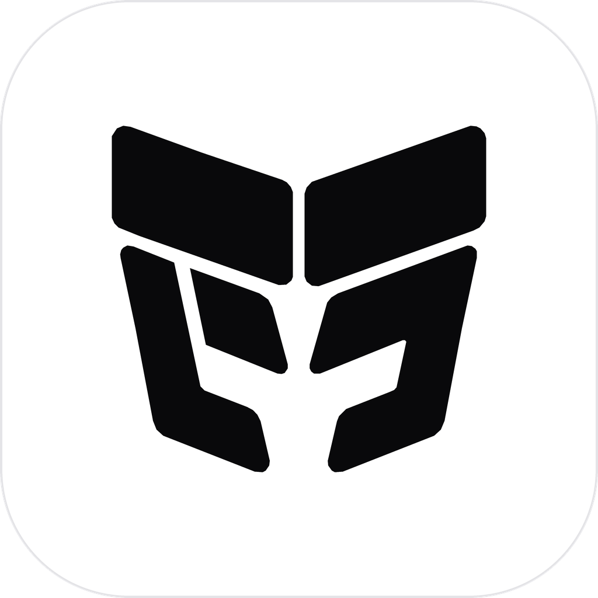
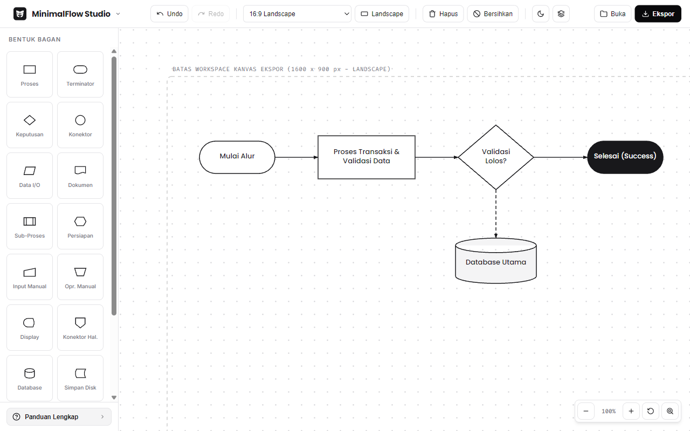

<p align="center">
  <a href="https://minimalflow-studio.vercel.app/">
    
  </a>
</p>

<h1 align="center">MinimalFlow Studio</h1>

<p align="center">
  <strong>Studio Diagram Alur &amp; Flowchart Monokrom Presisi Tinggi Berbasis Web</strong><br />
  Editor flowchart instan tanpa bundler yang dilengkapi AI Vision Scanner, impor Mermaid &amp; JSON otomotif, tata letak otomatis Sugiyama DAG, konektor magnetik cerdas, serta ekspor vektor SVG, PNG Retina, dan PDF.
</p>

<p align="center">
  <a href="https://minimalflow-studio.vercel.app/">
    
  </a>
  
  
  
</p>

<p align="center">
  <a href="#pratinjau-antarmuka">Pratinjau</a> &bull;
  <a href="#fitur--kapabilitas-utama">Fitur Utama</a> &bull;
  <a href="#pintasan-keyboard">Pintasan</a> &bull;
  <a href="#cara-menjalankan">Cara Menjalankan</a> &bull;
  <a href="#lisensi">Lisensi</a>
</p>

---

## Pratinjau Antarmuka

<p align="center">
  
</p>

<p align="center">
  <sub>Tampilan kanvas monokrom MinimalFlow Studio dengan katalog bentuk bagan standar, batas kanvas ekspor 16:9, konektor magnetik otomatis, dan kontrol ekspor langsung.</sub>
</p>

---

## Fitur & Kapabilitas Utama

1. **Instan & Ringan (Vanilla Web Standards):**
   - Berjalan murni di peramban web modern tanpa proses kompilasi atau bundler berat.
   - Langsung dapat dijalankan dengan membuka berkas `minimalflow-studio/index.html`.
2. **AI Vision Scanner (*Image-to-Flowchart*):**
   - Mengintegrasikan Google Gemini Vision API langsung di sisi peramban (*client-side*).
   - Pindai tangkapan layar diagram, sketsa papan tulis, atau foto alur kerja agar otomatis direkonstruksi menjadi diagram vektor interaktif.
3. **Universal Diagram Importer & Tata Letak Otomatis Sugiyama DAG:**
   - **Mermaid (`.mmd` / `.mermaid`):** Parsing otomatis diagram alur hierarkis `TD` dan `LR` dengan tata letak Sugiyama DAG bebas tabrakan (*zero-collision*).
   - **Skema Kelistrikan & Relai (JSON):** Menerjemahkan wiring netlist standar otomotif DIN 72552 menjadi skema pin magnetik.
   - **Format CAD Native (`.flow.json`):** Simpan dan muat kembali proyek secara utuh kapan saja.
4. **Kontrol Kanvas & Transformasi Vektor Presisi:**
   - **8-Way Resize Handles & Alt Center-Scaling:** Pembesaran ke 8 arah hingga batas minimal 10x10 px, serta pembesaran simetris dari titik pusat dengan menahan `Alt`.
   - **Perataan, Nudge & Kunci Posisi:** Ratakan tengah vertikal (`Alt + C`) & horizontal (`Alt + M`), geser halus via tombol panah (5 px / 20 px), serta kunci posisi (`Ctrl + L`).
   - **Multi-Selection & Grouping:** Seleksi *marquee* (`Shift + Drag`), gabung grup (`Ctrl + G`), dan pisah grup (`Ctrl + Shift + G`).
5. **Kabel & Konektor Magnetik 4-Arah:**
   - 4 pin magnetik (Utara, Timur, Selatan, Barat) dengan 3 mode jalur (**Siku Orthogonal / Manhattan**, **Lengkung Bezier**, dan **Lurus**) serta fitur *Tap-to-Connect*.
6. **Editor Teks Kaya Terintegrasi:**
   - Klik ganda langsung pada bagan untuk mengedit teks dengan pemformatan per-kata/per-paragraf, penomoran bergaya Word, perataan *justify*, dan *auto-wrap* presisi.
7. **Ekspor Resolusi Tinggi:**
   - Vektor SVG murni terpotong presisi, PNG Transparan 2x Retina, PNG latar putih, JPG kualitas tinggi, serta dokumen PDF vektor (16:9, A4, Portrait/Landscape).

---

## Pintasan Keyboard

| Pintasan | Tindakan |
|---|---|
| `Ctrl + L` | Kunci / buka kunci posisi bagan |
| `Ctrl + D` | Duplikat bagan terpilih |
| `Ctrl + C` / `Ctrl + V` | Salin & tempel di tengah kanvas |
| `Ctrl + G` | Gabungkan ke dalam grup |
| `Ctrl + Shift + G` | Pisahkan grup |
| `Alt + C` | Ratakan tengah vertikal |
| `Alt + M` | Ratakan tengah horizontal |
| `Ctrl + ]` / `Ctrl + [` | Layer: naik / turun 1 tingkat |
| `Ctrl + Shift + ]` / `[` | Layer: paling depan / paling belakang |
| `Arrow Keys` | Geser bagan (5 px normal, 20 px dengan `Shift`) |
| `Alt + Drag Handle` | Perbesar simetris dari titik pusat |
| `Space + Drag` | Geser kanvas bebas (*Pan*) |
| `Double Click` | Edit teks langsung di dalam bagan |

---

## Cara Menjalankan

Buka berkas `minimalflow-studio/index.html` langsung di Chrome, Edge, atau Firefox, atau jalankan server HTTP lokal:

```powershell
git clone https://github.com/maulana-mash/Minimalflow-Studio.git
cd Minimalflow-Studio

# Menggunakan Python
python -m http.server 8000

# Atau menggunakan Node
npx serve .
```
Akses melalui peramban di `http://localhost:8000/minimalflow-studio/`.

---

## Lisensi

Proyek ini dilisensikan di bawah **MIT License**.
